# Napo Beauty – Diagrama entidad-relación

Boceto de la base de datos para SQL Server. El script completo está en
[`napobeauty_sqlserver.sql`](napobeauty_sqlserver.sql).

Este diagrama se ve como imagen en GitHub y en VS Code (con la extensión
"Markdown Preview Mermaid Support").

## Módulos

| Módulo | Tablas | Pantallas que lo usan |
|---|---|---|
| Seguridad | Rol, Permiso, RolPermiso, Usuario | Login, Usuarios (asignar permisos por rol) |
| Catálogo | Categoria, Marca, Proveedor, Producto, ProductoImagen | Productos, Proveedores, menú de categorías |
| Inventario | Compra, DetalleCompra, MovimientoInventario | Inventario |
| Clientes | Cliente, DireccionCliente, MetodoPagoCliente | Clientes, Mi cuenta, Direcciones, Métodos de pago |
| Vista cliente | Favorito, ListaDeseo, CarritoItem, Resena | Favoritos, Lista de deseos, Carrito, estrellas |
| Ventas | MetodoPago, Venta, DetalleVenta | Ventas, Mis pedidos, Dashboard |
| Devoluciones | Devolucion, DetalleDevolucion, DevolucionProveedor, DetalleDevolucionProveedor | Devoluciones (de clientes y a proveedores) |
| Puntos | Recompensa, MovimientoPuntos | Recompensas y Puntos |
| Reportes (vistas) | vw_StockBajo, vw_VentasPorDia, vw_ProductosMasVendidos, vw_CalificacionProducto, vw_ResumenCliente | Dashboard, Reportes |

## Diagrama

```mermaid
erDiagram
    Rol ||--o{ Usuario : "tiene"
    Rol ||--o{ RolPermiso : "otorga"
    Permiso ||--o{ RolPermiso : "asignado en"
    Usuario ||--o{ Venta : "registra"
    Usuario ||--o{ Compra : "registra"
    Usuario ||--o{ MovimientoInventario : "ajusta"
    Usuario ||--o{ Devolucion : "revisa"

    Categoria ||--o{ Categoria : "subcategorias"
    Categoria ||--o{ Producto : "clasifica"
    Marca ||--o{ Producto : "fabrica"
    Proveedor ||--o{ Producto : "surte"
    Producto ||--o{ ProductoImagen : "tiene"

    Proveedor ||--o{ Compra : "vende"
    Compra ||--|{ DetalleCompra : "incluye"
    Producto ||--o{ DetalleCompra : "comprado en"
    Producto ||--o{ MovimientoInventario : "historial"

    Cliente ||--o{ DireccionCliente : "tiene"
    Cliente ||--o{ MetodoPagoCliente : "guarda"
    Cliente ||--o{ Favorito : "marca"
    Cliente ||--o{ ListaDeseo : "desea"
    Cliente ||--o{ CarritoItem : "agrega"
    Cliente ||--o{ Resena : "escribe"
    Producto ||--o{ Favorito : "en favoritos"
    Producto ||--o{ ListaDeseo : "en lista"
    Producto ||--o{ CarritoItem : "en carrito"
    Producto ||--o{ Resena : "recibe"

    Cliente |o--o{ Venta : "compra"
    MetodoPago ||--o{ Venta : "paga con"
    DireccionCliente |o--o{ Venta : "envio a"
    Venta ||--|{ DetalleVenta : "incluye"
    Producto ||--o{ DetalleVenta : "vendido en"

    Venta ||--o{ Devolucion : "genera"
    Devolucion ||--|{ DetalleDevolucion : "incluye"
    DetalleVenta ||--o{ DetalleDevolucion : "devuelto en"
    Proveedor ||--o{ DevolucionProveedor : "recibe"
    Devolucion ||--o{ DevolucionProveedor : "se envía en"
    DevolucionProveedor ||--|{ DetalleDevolucionProveedor : "incluye"
    Producto ||--o{ DetalleDevolucionProveedor : "devuelto en"

    Cliente ||--o{ MovimientoPuntos : "acumula"
    Venta |o--o{ MovimientoPuntos : "otorga"
    Recompensa |o--o{ MovimientoPuntos : "canjeada en"
    Producto |o--o{ Recompensa : "regalo"

    Rol {
        int RolId PK
        nvarchar Nombre UK
    }
    Usuario {
        int UsuarioId PK
        int RolId FK
        nvarchar NombreUsuario UK
        nvarchar Correo UK
        nvarchar ContrasenaHash
        bit Activo
    }
    Permiso {
        int PermisoId PK
        nvarchar Codigo UK
        nvarchar Modulo
        nvarchar Accion
    }
    RolPermiso {
        int RolId PK, FK
        int PermisoId PK, FK
        bit Activo
    }
    Categoria {
        int CategoriaId PK
        int CategoriaPadreId FK
        nvarchar Nombre
        nvarchar Icono
    }
    Marca {
        int MarcaId PK
        nvarchar Nombre UK
    }
    Proveedor {
        int ProveedorId PK
        nvarchar NombreEmpresa
        nvarchar RUC UK
        nvarchar Telefono
    }
    Producto {
        int ProductoId PK
        nvarchar SKU UK
        nvarchar Nombre
        int CategoriaId FK
        int MarcaId FK
        int ProveedorId FK
        decimal PrecioCompra
        decimal PrecioVenta
        int StockActual
        int StockMinimo
        bit Activo
    }
    ProductoImagen {
        int ProductoImagenId PK
        int ProductoId FK
        nvarchar Ruta
        bit EsPrincipal
    }
    Compra {
        int CompraId PK
        int ProveedorId FK
        int UsuarioId FK
        datetime2 Fecha
        decimal Total
        nvarchar Estado
    }
    DetalleCompra {
        int DetalleCompraId PK
        int CompraId FK
        int ProductoId FK
        int Cantidad
        decimal CostoUnitario
    }
    MovimientoInventario {
        int MovimientoInventarioId PK
        int ProductoId FK
        int UsuarioId FK
        nvarchar Tipo
        int Cantidad
        int StockAnterior
        int StockNuevo
    }
    Cliente {
        int ClienteId PK
        nvarchar Nombre
        nvarchar Correo UK
        nvarchar ContrasenaHash
        int PuntosDisponibles
    }
    DireccionCliente {
        int DireccionClienteId PK
        int ClienteId FK
        nvarchar Departamento
        nvarchar Municipio
        nvarchar DireccionExacta
        bit EsPredeterminada
    }
    MetodoPagoCliente {
        int MetodoPagoClienteId PK
        int ClienteId FK
        nvarchar Tipo
        char UltimosDigitos
        nvarchar TokenPasarela
    }
    Favorito {
        int ClienteId PK, FK
        int ProductoId PK, FK
    }
    ListaDeseo {
        int ClienteId PK, FK
        int ProductoId PK, FK
    }
    CarritoItem {
        int ClienteId PK, FK
        int ProductoId PK, FK
        int Cantidad
    }
    Resena {
        int ResenaId PK
        int ProductoId FK
        int ClienteId FK
        tinyint Calificacion
    }
    MetodoPago {
        int MetodoPagoId PK
        nvarchar Nombre UK
    }
    Venta {
        int VentaId PK
        nvarchar NumeroFactura UK
        nvarchar Canal
        int ClienteId FK
        int UsuarioId FK
        int MetodoPagoId FK
        int DireccionClienteId FK
        decimal Total
        nvarchar Estado
        bit Activo
    }
    DetalleVenta {
        int DetalleVentaId PK
        int VentaId FK
        int ProductoId FK
        int Cantidad
        decimal PrecioUnitario
    }
    Devolucion {
        int DevolucionId PK
        int VentaId FK
        int UsuarioId FK
        nvarchar Motivo
        nvarchar TipoResolucion
        nvarchar Estado
    }
    DetalleDevolucion {
        int DetalleDevolucionId PK
        int DevolucionId FK
        int DetalleVentaId FK
        int Cantidad
        bit RegresaAInventario
        nvarchar Destino
    }
    DevolucionProveedor {
        int DevolucionProveedorId PK
        int ProveedorId FK
        int DevolucionId FK
        int UsuarioId FK
        nvarchar Origen
        nvarchar Motivo
        nvarchar Resolucion
        nvarchar Estado
        decimal MontoCredito
    }
    DetalleDevolucionProveedor {
        int DetalleDevolucionProveedorId PK
        int DevolucionProveedorId FK
        int ProductoId FK
        int Cantidad
        decimal CostoUnitario
    }
    Recompensa {
        int RecompensaId PK
        nvarchar Nombre
        int PuntosRequeridos
        int ProductoRegaloId FK
    }
    MovimientoPuntos {
        int MovimientoPuntosId PK
        int ClienteId FK
        int VentaId FK
        int RecompensaId FK
        nvarchar Tipo
        int Puntos
    }
```

## Decisiones de diseño

- **Una sola tabla de ventas** para la tienda física y los pedidos en línea (columna `Canal`).
  Así el dashboard y los reportes suman todo junto, y "Mis pedidos" del cliente es un filtro por `ClienteId`.
- **Categorías y subcategorías en la misma tabla** (`CategoriaPadreId`), igual que el menú "Todas las categorías".
- **El precio se copia al detalle de la venta** (`PrecioUnitario`), para que cambiar el precio de un producto no altere ventas pasadas.
  Por la misma razón el pedido guarda una copia de la dirección de envío (`DireccionEnvio`).
- **El stock vive en `Producto.StockActual`** y cada cambio queda registrado en `MovimientoInventario`
  (entrada por compra, salida por venta, ajuste manual o devolución).
- **Los puntos funcionan igual:** el saldo está en `Cliente.PuntosDisponibles` y el historial en `MovimientoPuntos`.
- **Métodos de pago seguros:** solo se guarda el token de la pasarela y los últimos 4 dígitos, nunca el número completo ni el CVV.
- **Nada se borra.** Productos, ventas, clientes, usuarios y demás registros se habilitan o deshabilitan con la columna
  `Activo` (1 = habilitado, 0 = deshabilitado). Cada tabla tiene un trigger que rechaza cualquier `DELETE`.
  Los detalles (`DetalleVenta`, `DetalleCompra`, `DetalleDevolucion`) siguen al documento principal, y los historiales
  (`MovimientoInventario`, `MovimientoPuntos`) se corrigen con un movimiento de tipo "Ajuste".
- **Dos roles:** *Administrador* (es el único que crea, edita y habilita/deshabilita) y *Vendedor/Cajero*
  (consulta productos, inventario, clientes, devoluciones y ventas, y registra ventas).
- **Permisos por rol:** cada permiso es un módulo + una acción (`ver`, `crear`, `editar`, `habilitar`, `exportar`),
  por ejemplo `productos.habilitar` o `ventas.crear`. No existe la acción "eliminar".
  Los usuarios reciben permisos a través de su rol (`RolPermiso`); quitarle un permiso a un rol es poner `Activo = 0`.
- **Clientes de mostrador:** `Cliente.Correo` y `ContrasenaHash` pueden ser NULL. Si el cliente crea su cuenta en línea, se completan.
